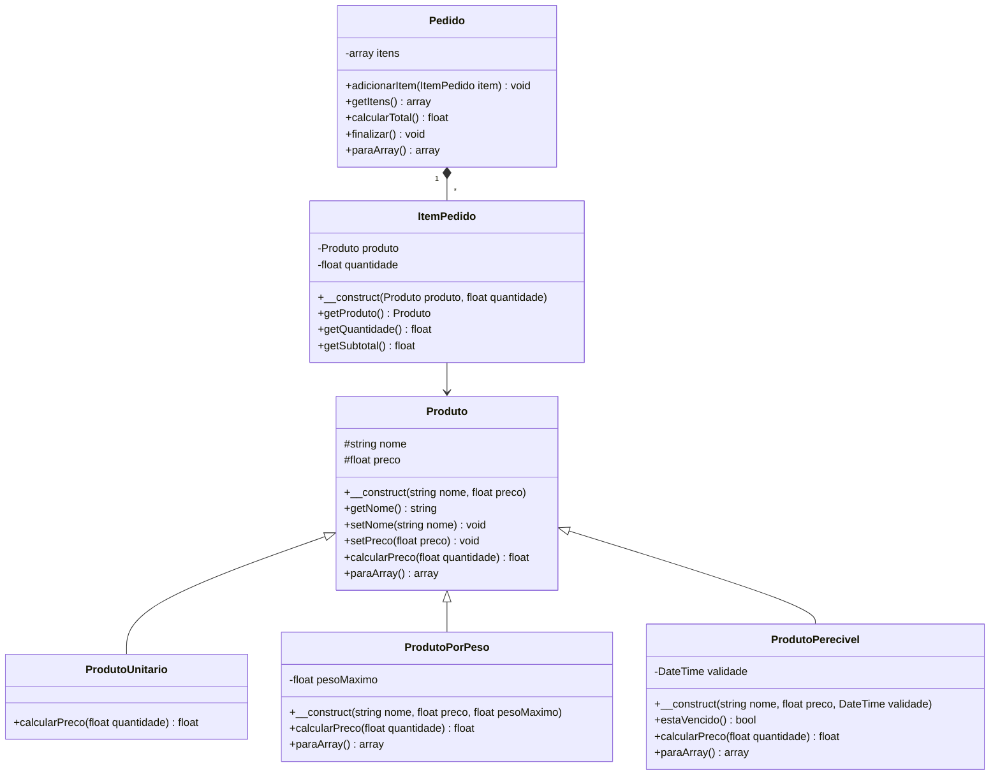

# Modelagem

## Diagrama de classes

Substitua o exemplo abaixo (tema 01, Feira Digital do Sertão) pelo diagrama do seu sistema.
Legenda: `<|--` herança ("é um"), `*--` composição ("tem um"), `#` protected, `-` private, `+` public.

## Justificativas

### Herança

A classe mãe é a Produto, que concentra o nome e o preço (atributos protected) e o método calcularPreco(). As classes filhas são:

ProdutoUnitario (é um Produto vendido por unidade).

ProdutoPorPeso (é um Produto vendido por quilo).

ProdutoPerecivel (é um Produto que tem data de validade).

A frase "X é um Y" vale para todas, pois cada filha é um tipo específico de produto da feira.

O método sobrescrito é o calcularPreco(float $quantidade).

Em ProdutoPorPeso, ele é sobrescrito para validar se a quantidade (peso) não ultrapassa o pesoMaximo.

Em ProdutoPerecivel, ele é sobrescrito para aplicar 20% de desconto automático caso a validade esteja a 3 dias ou menos do vencimento, usando a função DateTime::diff().

### Composição

A classe Pedido guarda uma lista de objetos ItemPedido. A relação é "tem um" (um Pedido tem vários Itens), e não "é um" (um Pedido não é um Item). Além disso, o Pedido é o responsável por gerenciar essa lista, adicionando itens com adicionarItem() e calculando o total com calcularTotal().

### Encapsulamento

Nenhum atributo é público (todos são private ou protected).

Onde tem setter: apenas em Produto, para nome e preco (pois o feirante pode precisar alterar o nome ou o preço). Esses setters têm validação (recusam nome vazio e preço menor ou igual a zero).

Onde NÃO tem setter: em ProdutoPorPeso (pesoMaximo), ProdutoPerecivel (validade), ItemPedido (produto e quantidade) e Pedido (itens). Esses dados são definidos no construtor e não devem ser alterados depois de criados. Para acessá-los, existem apenas getters (ex: getItens()).
