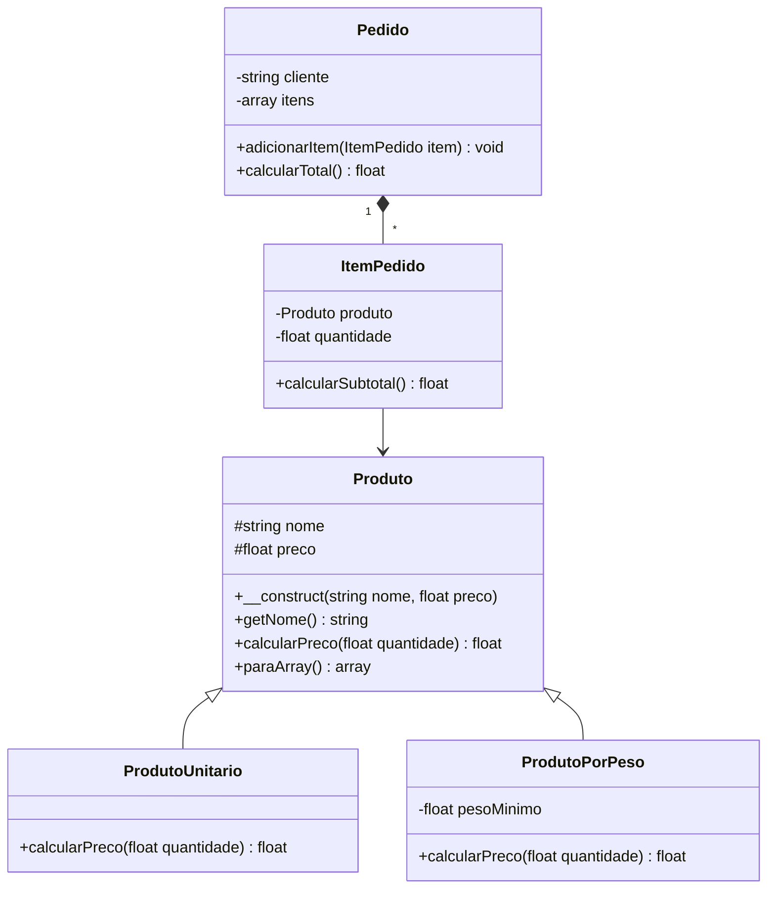

# Modelagem

## Diagrama de classes

Substitua o exemplo abaixo (tema 01, Feira Digital do Sertão) pelo diagrama do seu sistema.
Legenda: `<|--` herança ("é um"), `*--` composição ("tem um"), `#` protected, `-` private, `+` public.

## Justificativas

### Herança

_(Qual é a classe mãe, quais são as filhas e por que a frase "X é um Y" vale para cada uma. Qual método é sobrescrito e por quê.)_

### Composição

_(Qual classe guarda uma lista de objetos de outra e por que a relação é "tem um", e não "é um".)_

### Encapsulamento

_(Quais atributos têm getter, quais têm setter e por que alguns não têm setter.)_
